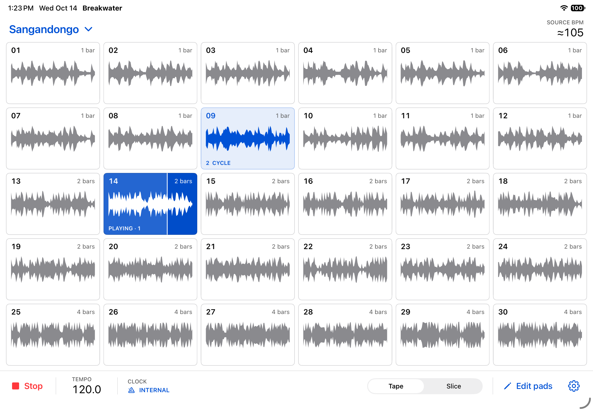

# Breakwater

A native iPad instrument for playing Niagara drum loops alongside a MIDI-synchronized synth jam. iPadOS 17+, designed for an A12 iPad. Includes 30 Sangandongo loops and 30 Malanga loops.



## Performance behavior

- The song dropdown opens each source song’s page of waveform pads. Browsing pages never stops the audio.
- Tap a pad to replace the current loop on the next four-beat bar boundary. With internal clock stopped, tapping starts that pad immediately.
- Hold one pad and touch additional pads to form an ordered cycle. The cycle stays latched when you release your fingers. Each selected sample plays its full one-, two-, or four-bar length, then the next sample plays. The next fresh gesture replaces the cycle at the next bar.
- `Edit pads` toggles persistent exclusions. Disabled pads remain visible so they can be restored. They cannot be launched by touch or MIDI and are removed from cycles. Disabling the playing pad changes to the next valid selection on a bar boundary; if none remains, playback fades out.
- **Tape** follows tempo by changing playback rate and pitch together.
- **Slice** schedules precomputed drum transients against the beat clock, plays their attacks at original pitch, and uses short crossfades / decaying tail extension. It preserves the original internal swing, rather than quantizing every hit to a rigid subdivision. Extreme tempo changes can reveal slicing artifacts.

## MIDI and audio

Connect the clock source's MIDI OUT to the CME U2MIDI Pro's white **TO MIDI OUT** plug; connect its USB end to the iPad through Apple's USB camera adapter. Audio goes separately from the iPad's headphone output or an audio interface to your mixer.

Select the MIDI source and enable external clock in Settings. Incoming MIDI Clock, Start, Stop, Continue and Song Position Pointer are supported. Start establishes bar one; Align downbeat can establish it when joining a running jam. Note numbers 36–65 trigger pads 01–30 on the displayed song page. Note release latches the selection, like finger release. Notes are accepted on all channels.

Clock smoothing and a phase correction loop reject small timing jitter without jumping the sample cursor. Tempo changes slew over roughly 90 ms, in addition to the short incoming-clock measurement window. If clock vanishes, playback briefly freewheels; after two seconds it fades out and waits for transport restart. The latency offset advances playback for positive values. Physical timing should be calibrated against the actual audio output.

The app requests a 256-frame audio buffer at 48 kHz; iPadOS chooses the available hardware configuration. All samples load before playback. Rendering uses owned in-memory PCM and a bounded single-producer command ring; the render callback performs no file I/O, locks, allocation, or Swift UI work. Audio can continue in the background. Audio interruptions stop playback; a disconnected output requires a deliberate restart.

## Build

See [INSTALL.md](INSTALL.md) for the first physical iPad run and MIDI hookup.

Open `Breakwater.xcodeproj` in Xcode. Select the **Breakwater** scheme, choose your personal Apple development team under Signing & Capabilities, and select the iPad or an iPad Simulator. The app requires no package downloads. Apple signing is separate from the GitHub commit identity.

The committed Xcode project can be regenerated with `python3 Scripts/generate_project.py`. The WAV files and `Samples/catalog.json` are already prepared; the Python audio-analysis dependencies are not required to build the app.

## Checks

```sh
Scripts/test_core.sh
Scripts/test_interactions.sh
```

The first compiles the portable audio engine with AddressSanitizer and UndefinedBehaviorSanitizer. It tests bar-boundary replacements, full-length cycles, exclusions, clock jitter, tempo steps, phase lock, clock loss, MIDI transport, and pitch behavior. The second tests gesture latching, MIDI parsing, and every shipped sample's format and metadata.

Run native UI tests with `Scripts/test_simulator.sh <iPad Simulator UDID>`. Results and physical-device limitations are recorded in [VALIDATION.md](VALIDATION.md).

## Sample provenance

See [Samples/README.md](Samples/README.md). The WAVs are committed directly for this initial version. They remain separate from the source code's ownership and are not presented as freely licensed sample content.
